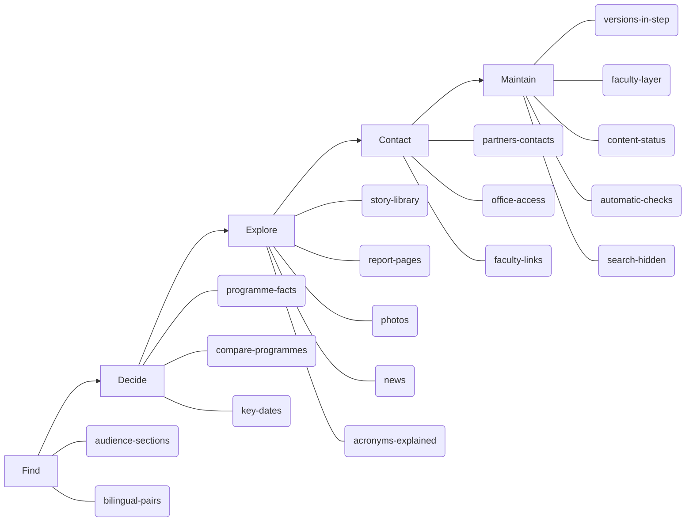

# Feature map

<!-- Drawn by scripts/draw-features.mjs from docs/features.yaml. Do not edit by hand. -->

| Stage | Feature | What it does | Status | Checked by |
| --- | --- | --- | --- | --- |
| Find | `audience-sections` | Visitors find content by what they want to do, in five sections. | works | pairing |
| Find | `bilingual-pairs` | Every page exists in English and Japanese, and the language switch opens the same page in the other language. | works | pairing |
| Decide | `programme-facts` | Each programme's key facts appear in a box on its page, from one data file. | works | programme-references |
| Decide | `compare-programmes` | Visitors can compare programmes side by side. | works | programme-references |
| Decide | `key-dates` | The home page lists deadlines, and never shows a passed deadline as open. | works | deadlines |
| Explore | `story-library` | Visitors can filter student stories by type, country and year, share or link a filtered list by its address, and open the full report; the Japanese list opens on Nagoya students abroad. | works | data-files |
| Explore | `report-pages` | Every student report has its own page in English and Japanese; the version that is not the original is an automatic translation, labelled as such, with a link to the original. *Limit: Translations are automatic (AI) and have not been checked by a person.* | works | report-translations |
| Explore | `photos` | Pages, reports and the team list show photos, each with a description in both languages for screen readers. | works | photo-descriptions, images |
| Explore | `news` | Every news item has its own page in both languages; the list can be filtered by type and partner, and past events and closed calls are labelled. | works | data-files |
| Contact | `partners-contacts` | Partner universities and contact points come from data files and stay consistent everywhere. | works | data-files |
| Contact | `office-access` | Visitors find the office's building, floor and room, step-by-step directions from Tsurumai Station, a route map and the printable route guide. | works | pairing, images, internal-links |
| Explore | `acronyms-explained` | Every abbreviation says what it stands for where it is first used on a page, with a list at the end of the page, links to the institutions, and a full list of abbreviations. *Limit: Abbreviations in texts drawn from the data files (programme boxes, partner names, news) are listed on the abbreviations page but not marked where they appear.* | works | acronyms |
| Contact | `faculty-links` | The site shows where it sits in the faculty website and sends visitors to the faculty's directory entry for the team, research and publications. | works | internal-links, faculty-texts |
| Maintain | `versions-in-step` | No English or Japanese version of a page, fact, photo description or report translation can fall behind the other without the check failing. | works | versions-in-step, facts-match, translations-current |
| Maintain | `faculty-layer` | The texts for the faculty website are generated from the site's data, and a weekly check compares the live faculty pages with the site. *Limit: The International section rule stays pending until the faculty's web team publishes the gateway texts. Problems the faculty has not fixed yet are listed as known gaps (faculty.json knownGaps) until they are.* | works | faculty-texts, faculty-live |
| Maintain | `content-status` | Editors see every fact that still needs confirming on one checklist page; public pages show only a one-line pointer to it. | works | data-files |
| Maintain | `automatic-checks` | Every change is checked for missing translations, passed deadlines, large images and broken internal links before it is published. | works | pairing, deadlines, images, internal-links |
| Maintain | `search-hidden` | The prototype stays out of search engines so it never competes with the official sites. *Limit: Remove before moving to production.* | works | noindex |
