# Feature map

```mermaid
flowchart LR
  S0["Find"]
  S1["Decide"]
  S2["Explore"]
  S3["Contact"]
  S4["Maintain"]
  S0 --> S1
  S1 --> S2
  S2 --> S3
  S3 --> S4
  S0 --- audience_sections("audience-sections")
  S0 --- bilingual_pairs("bilingual-pairs")
  S1 --- programme_facts("programme-facts")
  S1 --- compare_programmes("compare-programmes")
  S1 --- dated_facts("dated-facts")
  S0 --- site_search("site-search")
  S1 --- calendar_and_feed("calendar-and-feed")
  S1 --- key_dates("key-dates")
  S2 --- story_library("story-library")
  S2 --- report_pages("report-pages")
  S2 --- photos("photos")
  S2 --- news("news")
  S3 --- partners_contacts("partners-contacts")
  S3 --- office_access("office-access")
  S2 --- acronyms_explained("acronyms-explained")
  S2 --- japanese_only_summaries("japanese-only-summaries")
  S3 --- faculty_links("faculty-links")
  S4 --- versions_in_step("versions-in-step")
  S4 --- faculty_layer("faculty-layer")
  S4 --- content_status("content-status")
  S4 --- browser_editing("browser-editing")
  S4 --- web_editor("web-editor (partial)")
  S4 --- automatic_checks("automatic-checks")
  S4 --- weekly_check("weekly-check")
  S4 --- members_area("members-area")
  S4 --- tool_updates("tool-updates (partial)")
  S4 --- search_hidden("search-hidden")
  S4 --- any_host("any-host")
  S0 --- findable_at_launch("findable-at-launch")
  S0 --- privacy_accessibility("privacy-accessibility (partial)")
```

<!-- Drawn by scripts/draw-features.mjs from docs/features.yaml. Do not edit by hand. -->

| Stage | Feature | What it does | Status | Checked by |
| --- | --- | --- | --- | --- |
| Find | `audience-sections` | Visitors find content by what they want to do, in five sections, with home-page entries for prospective partners, companies, Nagoya faculty, parents and the press. | works | pairing |
| Find | `bilingual-pairs` | Every page exists in English and Japanese, and the language switch opens the same page in the other language. | works | pairing |
| Decide | `programme-facts` | Each programme's key facts appear in a box on its page, from one data file. | works | programme-references |
| Decide | `compare-programmes` | Visitors can compare programmes side by side, including the English test and scores each one requires. | works | programme-references |
| Decide | `dated-facts` | Each programme box and each page says when its facts were last checked against the official pages, and how many details the office is still confirming, with a link to them. *Limit: The date says when the facts were compared with their sources, not when the office confirmed them; all are 25 November 2026 until someone checks again. Pages with no source on the university's sites, and draft translations, show "Last updated" instead.* | works | dated-facts |
| Find | `site-search` | Visitors can search every page, programme, story and news item in their language, from a search link in the header. *Limit: Search needs JavaScript; without it the page points to the menu, the programme list and the stories. Each language searches its own pages.* | works | search-index |
| Decide | `calendar-and-feed` | Visitors can subscribe to a calendar of coming deadlines and events and to a news feed, and add a programme's deadline to their calendar from its box. *Limit: The calendar is empty until the office records dated deadlines or coming events; no programme has a dated deadline today.* | works | feeds |
| Decide | `key-dates` | The home page lists deadlines, and never shows a passed deadline as open. | works | deadlines |
| Explore | `story-library` | Visitors can filter student stories by type, country and year, share or link a filtered list by its address, and open the full report; the Japanese list opens on Nagoya students abroad. | works | data-files |
| Explore | `report-pages` | Every student report has its own page in English and Japanese; the version that is not the original is an automatic translation, labelled as such, with a link to the original. *Limit: Translations are automatic (AI) and have not been checked by a person.* | works | report-translations |
| Explore | `photos` | Pages, reports and the team list show photos, each with a description in both languages for screen readers. | works | photo-descriptions, images |
| Explore | `news` | Every news item has its own page in both languages; the list can be filtered by type and partner, and past events and closed calls are labelled. | works | data-files |
| Contact | `partners-contacts` | Partner universities and contact points come from data files and stay consistent everywhere; the partner list can be searched and filtered by region and link, with counts, and opened on one filter from another page. | works | data-files |
| Contact | `office-access` | Visitors find the office's building, floor and room, step-by-step directions from Tsurumai Station, a route map and the printable route guide. | works | pairing, images, internal-links |
| Explore | `acronyms-explained` | Every abbreviation says what it stands for where it is first used on a page, with a list at the end of the page, links to the institutions, and a full list of abbreviations; links to pages in the other language or to PDFs say so. *Limit: Abbreviations in texts drawn from the data files (programme boxes, partner names, news) are listed on the abbreviations page but not marked where they appear.* | works | acronyms, content-plugin |
| Explore | `japanese-only-summaries` | When an English page links to a page that exists only in Japanese, an English summary of that page, marked as written automatically, opens under the link. *Limit: Summaries are checked against the page on the date they were written; the weekly check reports a broken link but not a changed page. PDF files are not required to have one.* | works | ja-summaries, content-plugin |
| Contact | `faculty-links` | The site shows where it sits in the faculty website and sends visitors to the faculty's directory entry for the team, research and publications. | works | internal-links, faculty-texts |
| Maintain | `versions-in-step` | No English or Japanese version of a page, fact, photo description or report translation can fall behind the other without the check failing. | works | versions-in-step, facts-match, translations-current |
| Maintain | `faculty-layer` | The texts for the faculty website are generated from the site's data, and a weekly check compares the live faculty pages with the site. *Limit: The International section rule stays pending until the faculty's web team publishes the gateway texts. Problems the faculty has not fixed yet are listed as known gaps (faculty.json knownGaps) until they are.* | works | faculty-texts, faculty-live |
| Maintain | `content-status` | Editors see every fact that still needs confirming on one checklist page; public pages show only a one-line pointer to it. | works | data-files |
| Maintain | `browser-editing` | Office staff can edit in the browser and record that both languages are in step from the Actions tab, with nothing to install. *Limit: Commits made by the workflow do not start the pull request's checks again; the workflow runs the content and staleness checks itself.* | works | versions-in-step |
| Maintain | `web-editor` | Office staff update news, programme deadlines and facts, contacts and page texts in an editing page in the browser (admin/), in Japanese, with nothing to install; each save goes through the checks before it is published. *Limit: Nobody can sign in until the repository owner sets up the free sign-in service (docs/editor-setup.md). A save is trusted as checked in both languages. Photos, new pages, partners and stories still need technical help. No save has been tried on the live site yet.* | partial | editor-config, versions-in-step |
| Maintain | `automatic-checks` | Every change is checked for missing translations, passed deadlines, large images and broken internal links before it is published. | works | pairing, deadlines, images, internal-links |
| Maintain | `weekly-check` | Every Monday the site is rebuilt and checked for broken outside links and deadlines to update, and anything found is reported in one issue for the office. *Limit: Sites that refuse automated checks never open an issue on their own; they are listed in the run summary, and in the issue when one is open. A very long report is cut to fit an issue, with the whole report in the run summary. GitHub pauses scheduled workflows after 60 days without a commit to the repository.* | works | weekly-check, deadlines |
| Maintain | `members-area` | The site links to the Frontier-kai members' area on the faculty server without holding any member data, and every Monday the check reports if that area stops asking for a password, disappears, or sends visitors elsewhere before asking. *Limit: The check sees what a visitor without the password sees. It cannot see a redirect applied only after sign-in (one written in an .htaccess file while the area keeps its password), and it cannot tell whether the password is strong or shared too widely. The rules that keep the folder safe at the switch (no deletion, no redirect that catches it, uploads that only add) and a member's sign-in after any redirect change are written in docs/launch.md, not enforced by the site.* | works | weekly-check, data-files |
| Maintain | `tool-updates` | Updates of the site's tools arrive once a month as pull requests, checked like any other change. *Limit: Security alerts and security updates are switched on in the repository's settings, not in this file.* | partial |  |
| Maintain | `search-hidden` | The prototype stays out of search engines so it never competes with the official sites. *Limit: One switch (src/lib/launch.mjs) turns it off at launch, with the other steps in docs/launch.md.* | works | noindex |
| Maintain | `any-host` | The same site builds for GitHub Pages or for the faculty server at www.med.nagoya-u.ac.jp/intlexch/ by setting two values, with the same checks, and a workflow offers the build for the server as a zip. *Limit: Getting the files onto the server (by hand, fetched by the server, or sent over SFTP) and the server settings (404 page, file types, redirects) are for faculty IT to choose and set.* | works | internal-links |
| Find | `findable-at-launch` | Search engines get a sitemap with both languages and structured data for the office, each page's place in the site and each programme, ready to be announced at launch. *Limit: Events are not described as events, because the news data has no place for them. robots.txt counts only at the root of a host; under /intlexch/ the faculty adds the sitemap line to its own.* | works | sitemap, structured-data |
| Find | `privacy-accessibility` | Visitors can read what the site records about them and how it is made accessible, and how to report a problem. *Limit: Both pages describe the prototype. The statements for the launched site, the accessibility target and any measurement of visits are to be agreed with the faculty (docs/launch.md).* | partial | pairing, no-outside-resources |
