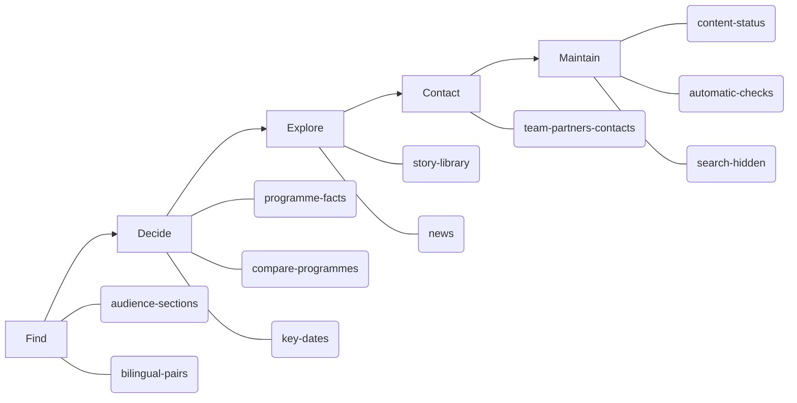

# Feature map

<!-- Drawn by scripts/draw-features.mjs from docs/features.yaml. Do not edit by hand. -->

| Stage | Feature | What it does | Status | Checked by |
| --- | --- | --- | --- | --- |
| Find | `audience-sections` | Visitors find content by what they want to do, in five sections. | works | pairing |
| Find | `bilingual-pairs` | Every page exists in English and Japanese, and the language switch opens the same page in the other language. | works | pairing |
| Decide | `programme-facts` | Each programme's key facts appear in a box on its page, from one data file. | works | programme-references |
| Decide | `compare-programmes` | Visitors can compare programmes side by side. | works | programme-references |
| Decide | `key-dates` | The home page lists deadlines, and never shows a passed deadline as open. | works | deadlines |
| Explore | `story-library` | Visitors can filter student stories by type, country and year, and open the full report. | works | data-files |
| Explore | `news` | News and events are listed by year, with past items marked as archive. | works | data-files |
| Contact | `team-partners-contacts` | Team, partner universities and contact points come from data files and stay consistent everywhere. | works | data-files |
| Maintain | `content-status` | Editors see every fact that still needs confirming, on each page and on one checklist page. | works | data-files |
| Maintain | `automatic-checks` | Every change is checked for missing translations, passed deadlines, large images and broken internal links before it is published. | works | pairing, deadlines, images, internal-links |
| Maintain | `search-hidden` | The prototype stays out of search engines so it never competes with the official sites. *Limit: Remove before moving to production.* | works | noindex |
